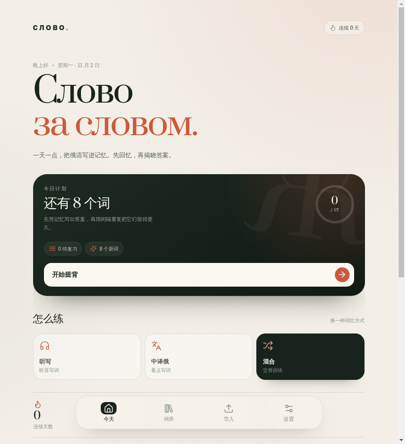
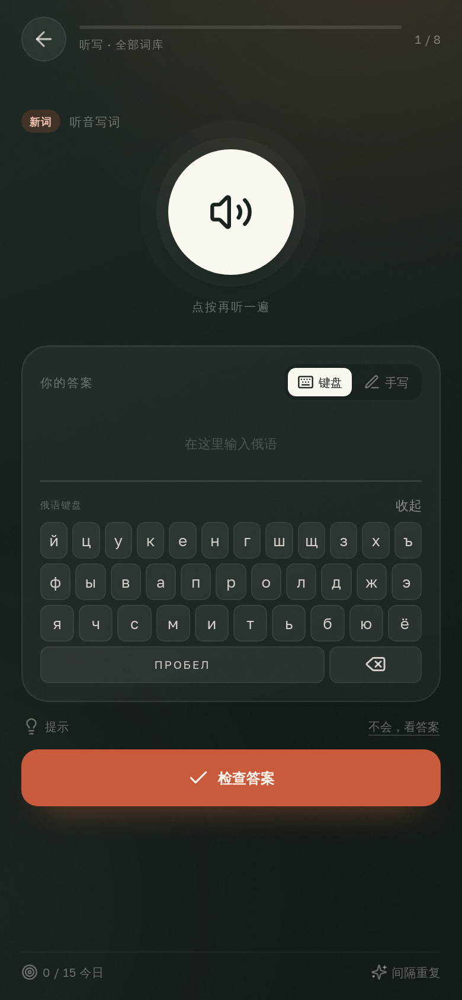

# СЛОВО — 俄语单词提背

当前版本：`1.4.0`。

СЛОВО 是一个本地优先的俄语单词提背产品，同一套学习逻辑现在提供四种运行方式：

- **Android**：原生 WebView 壳 + 内置本地资源服务器，APK 可直接安装。
- **Windows**：Electron 免安装版，解压即用。
- **Linux**：Electron 免安装版，提供 x64 与 arm64。
- **浏览器 PWA**：可安装到主屏幕，支持离线打开。

这一版重点补了“能不能用”的兜底和自适应，而不是继续堆功能：

- **自适应**：320px 手机到 1280px 桌面窗口都有独立断点；小屏评分 2×2，输入区不横向溢出。
- **字号**：设置 → 显示与字号，四档即时生效并持久化；Android WebView 同步 `textZoom`。
- **手写**：在线失败/超时自动离线；离线单词模式识别；失败有明确键盘入口。
- **发音**：优先选择设备上的本地离线俄语 voice，跳过需要联网的 voice；设置页显示实际 voice 名称，可直接试听。
- **听写**：没有俄语 TTS 时显示中文释义，不再“点了没声音”。
- **数据**：存储写满、备份取消都会明确提示；Android 备份改为真实保存回调。

学习方式仍然是：主动回忆 → 揭晓答案 → 四档评分 → 间隔重复；支持听写、中译俄、混合练习、手写识别、照片 OCR 和多格式导入；界面会随手机、平板和桌面窗口自适应，字号也能在设置中调整。

## 直接使用

完整构建、测试证据、校验和与已知限制见：[`docs/verification-1.4.0.txt`](docs/verification-1.4.0.txt)。

### Android

安装包：[`slovo-1.4.0.apk`](../../releases/latest/download/slovo-1.4.0.apk)

- Android 8.0（API 26）及以上；`targetSdk 28`。
- 首次安装需允许“安装未知应用”。
- 这是 **debug 签名**的本地构建，用于个人安装测试；如果要上应用商店，请用自己的 release keystore 重新签名。
- APK 内置 OCR 模型、字体和前端资源，不依赖外部网页服务器；手写在线识别仍需要网络。

### Windows

压缩包：[`slovo-1.4.0-windows-x64.zip`](../../releases/latest/download/slovo-1.4.0-windows-x64.zip)

1. 解压到任意目录（不要直接在压缩包里运行）。
2. 双击 `Slovo.exe`。
3. 未做代码签名，Windows SmartScreen 可能提示；选择“更多信息 → 仍要运行”。

支持 Windows 10/11 x64。

### Linux

- x64：[`slovo-1.4.0-linux-x64.tar.gz`](../../releases/latest/download/slovo-1.4.0-linux-x64.tar.gz)
- arm64：[`slovo-1.4.0-linux-arm64.tar.gz`](../../releases/latest/download/slovo-1.4.0-linux-arm64.tar.gz)

```bash
tar -xzf slovo-1.4.0-linux-x64.tar.gz
./Slovo-linux-x64/Slovo
```

Linux 包里的 `Slovo` 是兼容启动脚本，实际二进制为 `Slovo-bin`；脚本会使用 `--no-sandbox`，避免解压后的 Electron `chrome-sandbox` 因非 root 文件权限而无法启动。应用只加载内置的本地页面。

如果系统没有 `/dev/shm`（部分容器环境），应用会自动追加 `--disable-dev-shm-usage`；普通桌面不需要手动处理。

### 浏览器 / PWA

```bash
npm install
npm run build
npm start
```

打开 `http://127.0.0.1:4173`。生产服务器同时提供 `/api/handwriting` 和 `/api/health`。

## 功能

- **四种输入**：拍照、照片 OCR、文件、粘贴文字。
- **文件格式**：TXT / MD / CSV / TSV / JSON / DOCX / XLSX / XLS / PDF 文本层 / HTML。
- **提背模式**：听写、中译俄、混合；俄语屏幕键盘、两级提示。
- **手写识别**：在线笔画识别（Google Input Tools，经本地代理）；无代理、离线或超时自动回退到本地 Tesseract，识别失败时可直接切回键盘修改。
- **照片 OCR**：Tesseract 本地运行（俄语 + 简体中文）；检测到纯拉丁误识别时自动补跑俄语校正。
- **记忆算法**：SM-2 思路的间隔重复，四档评分；答错词本轮末尾重排。
- **学习统计**：连续天数、每日目标、正确率、词库进度、掌握度。
- **本地优先**：词库、设置、记录保存在本机；JSON 备份可导出/恢复。
- **桌面缩放**：`Ctrl/Cmd + =` 放大、`Ctrl/Cmd + -` 缩小、`Ctrl/Cmd + 0` 复位；zoomFactor 与窗口位置一起持久化。
- **三端适配**：手机、平板、桌面自适应宽度；设置内提供“小 / 标准 / 大 / 特大”四档字号，Android 通过 WebView `textZoom` 生效，Web/桌面通过 CSS 变量生效。
- **失败兜底**：没有俄语 TTS 时听写自动显示中文释义；存储写满会提示导出备份；Android 备份保存/取消都有真实回调；服务不可用时手写自动转离线。

## 三端实现

```text
src/ + public/         共用 React 前端、OCR、SRS、数据层
        │
        ├── dist/ ── PWA / 浏览器
        ├── Electron 31 + 本地静态服务器 ── Windows / Linux
        └── Android WebView + AssetServer ── APK
```

- **Electron**：主进程在 `127.0.0.1` 随机端口启动 `server/http-server.mjs`，加载 `dist`；因此 OCR 资源、`/api/handwriting` 代理和 SPA 回退与网页版一致。
- **Android**：`MainActivity` 启动一个仅监听 `127.0.0.1` 的轻量 HTTP 服务器，从 APK `assets/www` 提供前端；原生层负责文件/相机选择、系统 TTS、备份保存和手写代理。
- **数据目录**：桌面端固定使用 `.../slovo`（Linux `~/.config/slovo`，Windows `%APPDATA%\slovo`），不会污染其他 Electron 应用的缓存。
- **Service Worker**：浏览器 PWA 使用 `slovo-v5` 缓存；Android/Electron 原生壳检测到原生环境后不注册 Service Worker，避免旧资源缓存。

## 开发与构建

要求：Node.js 20+、npm 10+。

```bash
npm install
npm run dev -- --port 4173
```

生产构建：

```bash
npm run build
npm start
```

### 桌面端

```bash
npm run desktop:linux       # Linux arm64
npm run desktop:linux-x64   # Linux x64
npm run desktop:win         # Windows x64
```

产物在 `release/`：

- `slovo-1.4.0-linux-arm64.tar.gz`
- `slovo-1.4.0-linux-x64.tar.gz`
- `slovo-1.4.0-windows-x64.zip`

打包器默认使用 Electron `31.7.7`。如果网络无法访问 GitHub，可先准备 Electron 运行时压缩包，再设置：

```bash
SLOVO_ELECTRON_ZIPS=/path/to/electron-zips node scripts/build-desktop.mjs linux arm64
```

### Android

Ubuntu/Debian 上安装构建依赖：

```bash
sudo apt install openjdk-17-jdk-headless android-sdk-build-tools \
  android-sdk-platform-23 aapt apksigner zipalign
```

然后：

```bash
npm run build
bash android/build-apk.sh
```

产物：`release/slovo-1.4.0.apk`。

构建链不依赖 Gradle 或 Android Studio：`aapt` 编译资源和 assets，`javac` 编译 Java，R8/D8 生成 `classes.dex`，`zipalign` 对齐，`apksigner` 签名。R8 已放在 `android/tools/r8.jar`。

> `aapt` 会自动解压 `.gz` 资源并去掉扩展名，因此构建脚本会把 OCR 模型改存为 `.bin`，本地服务器再把 `/tessdata/xxx.traineddata.gz` 映射到对应的 `.bin` 原始 gzip 字节。这样 Tesseract 的 `gzip: true` 在 Android 上仍然有效。

## 验证范围

已经完成：

- 前端生产构建、WebKit 移动端功能回归、PWA 离线打开。
- Linux arm64 Electron 包真实启动、820×900 窗口、导航、`/api/health`、Service Worker 关闭、720/920px 内容栏。
- APK 的 `aapt/d8/zipalign/apksigner` 全链路构建；包内 `classes.dex`、前端资源、`.bin` OCR 模型、ContentProvider 和签名均已检查。
- Windows x64 / Linux x64 归档结构与 `Slovo.exe`/`Slovo` 可执行文件检查。

未在本容器内完成：

- Android 实机安装（设备 ADB/Shizuku 通道当前拒绝连接）。APK 已导出到手机 Download，可手动安装验证。
- Windows 真机启动（容器是 aarch64 Linux，无法执行 Windows PE）。
- Linux x64 真机启动（容器是 aarch64）。
- ~~带嵌入字体的俄语 PDF 的端到端解析。~~ 已补测：`привет 你好 / спасибо 谢谢 / кошка 猫` 可正确提取并预览。

这些边界不影响源码和安装包本身，但发布前建议在目标机器上做一次安装冒烟测试。





## 已知限制

- 照片 OCR 对个别汉字仍可能误识别（例如「猫」读成「猜」）；导入预览可直接修改。
- PDF 只提取文本层；扫描版 PDF 请走拍照/照片 OCR。
- 在线手写会向 Google Input Tools 发送笔画坐标；可在设置中关闭，改用离线识别。
- Android 的俄语朗读依赖系统 TTS 是否安装了俄语声音；没有俄语声音时听写会显示中文释义降级作答，并提示安装系统语音。
- 数据默认只在本机；没有云同步。跨设备迁移请使用“设置 → 导出备份”再导入。
- Windows/Linux 包未做代码签名；Android 包为 debug 签名。

## 目录

```text
src/                     React 前端
public/                  OCR、字体、图标、Service Worker
server/                  共用静态服务器与手写代理
desktop/main.mjs         Electron 主进程
android/                 Android 原生壳与 APK 构建脚本
scripts/build-desktop.mjs
scripts/desktop-smoke.mjs
release/                 三端最终产物
```

## 数据与隐私

- 单词、学习记录默认只保存在当前设备。
- 照片 OCR 在本地完成，不上传图片。
- 在线手写只发送笔画坐标到 Google Input Tools；可在设置中关闭。Google 接口在部分网络环境不可达时，会自动使用离线识别。
- 没有账号、没有云端数据库、没有埋点。
